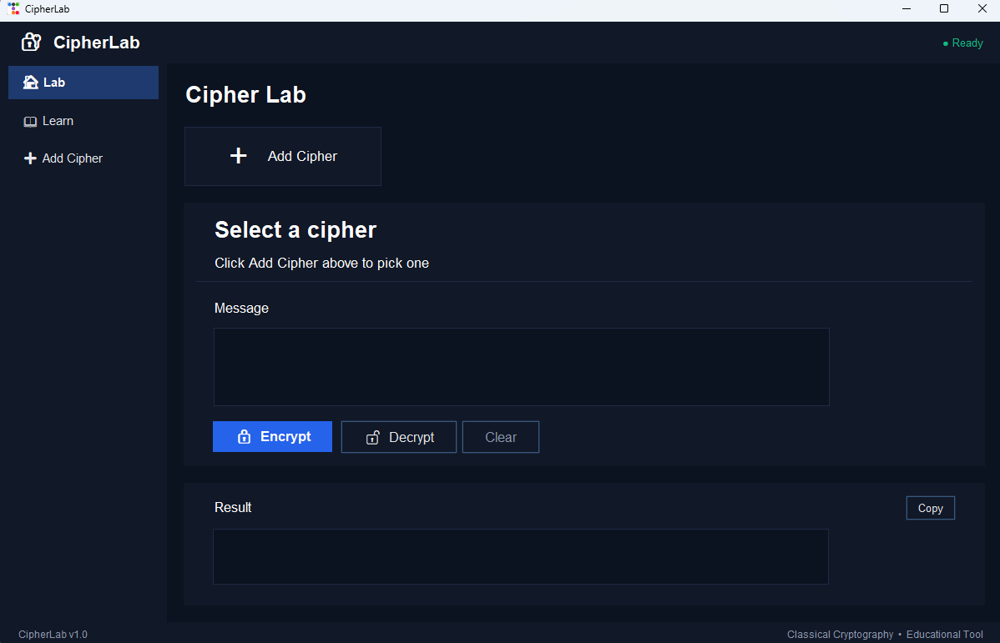
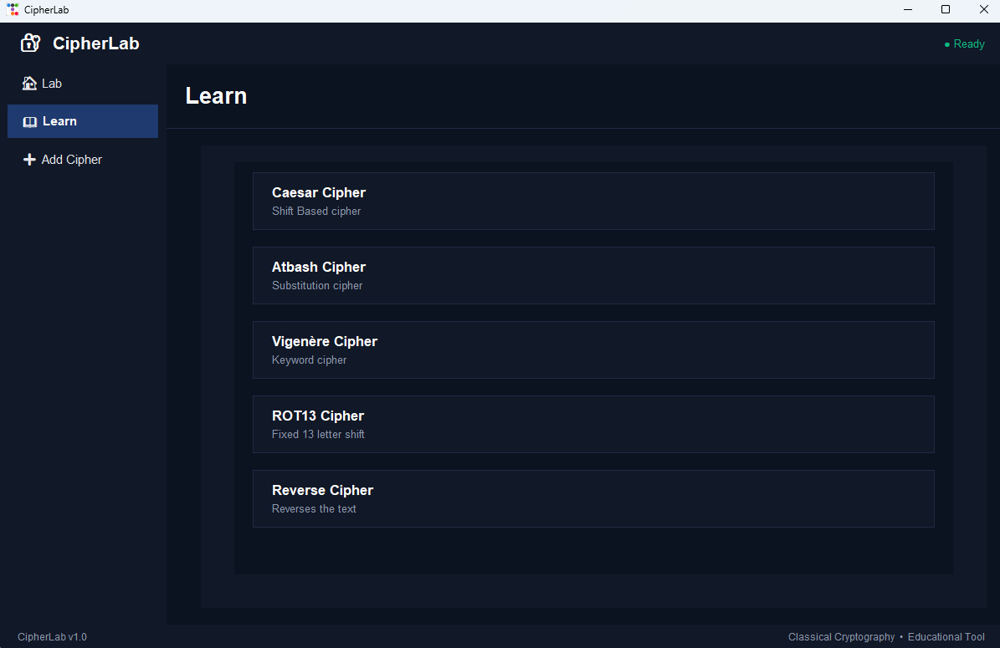
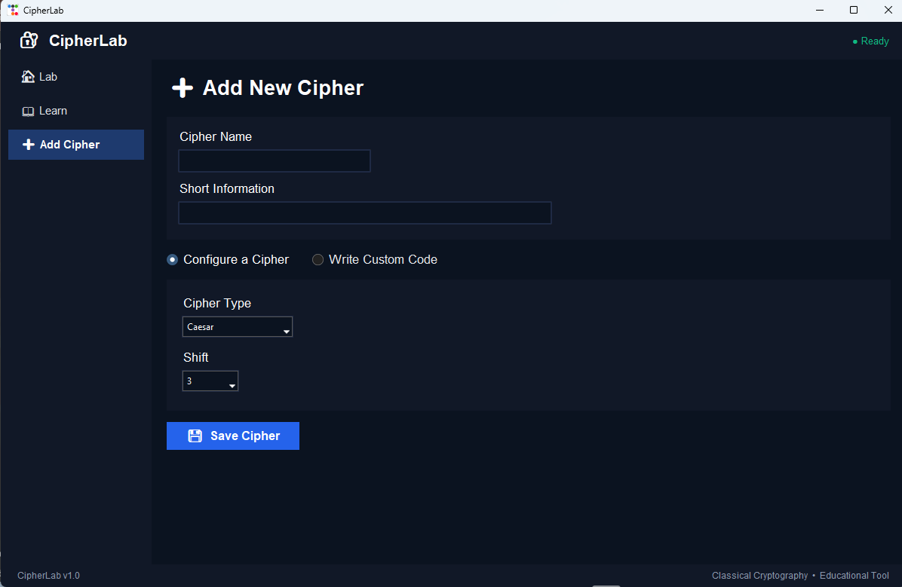

# 🔐 CipherLab

A desktop app for learning classical cryptography. Pick a cipher, encrypt and decrypt messages, read how each one works, and build your own.

Built with Python and [ttkbootstrap](https://ttkbootstrap.readthedocs.io/), using a dark theme.



## Download (Windows)

You don't need Python to use CipherLab.

1. Go to the [Releases page](../../releases) and download `CipherLab.zip`.
2. Unzip the whole folder anywhere.
3. Double-click `CipherLab.exe`.

Keep the files together. `CipherLab.exe` needs the other files in its folder, so don't move the exe on its own. A desktop shortcut to it is fine.

> **Windows may show a warning the first time you run it.** The app isn't code-signed, so SmartScreen or your antivirus may say it is unrecognised. Click **More info**, then **Run anyway**.

## Features

- **Lab**: encrypt and decrypt messages with the built-in ciphers:
  - Caesar (choose a shift from 1 to 25)
  - Atbash
  - Vigenère (choose a keyword)
  - ROT13
  - Reverse
- **Learn**: a lesson for each cipher with an explanation, the formula and a worked example. The Caesar lesson also shows the shifted alphabet.
- **Custom ciphers**: create your own cipher and get its own sidebar page, Learn lesson and Lab entry. There are two ways to make one:
  - **Configure a cipher**: choose Caesar, Vigenère or Substitution and save its settings.
  - **Write custom code**: write your own Python `encrypt(text)` and `decrypt(text)` functions.
- **Favourites**: the Lab keeps your 3 most recently used ciphers as quick-select cards.
- **Files**: open a `.txt` file as your message (up to 50,000 characters) and save the result to a file.
- **Copy and clear**: copy the result to the clipboard, or clear the message and result boxes.
- **Auto-save**: your custom ciphers, favourites and last-used cipher come back when you reopen the app.




## How to use

1. In the **Lab**, click **Add Cipher** and choose a cipher.
2. Type a message, set any options (such as the shift or keyword), then press **Encrypt** or **Decrypt**.
3. Open **Learn** to read how a cipher works.
4. Open **Add Cipher** in the sidebar to create your own cipher.
5. To remove a custom cipher, open its lesson in **Learn** and click **Delete this cipher** (click twice to confirm).

## Saved data

Your favourites and custom ciphers are stored in `~/.cipherlab/save.json`. Rebuilding or deleting the app does not remove this file.

To reset the app, delete that file:

1. Press `Win + R`.
2. Type `%USERPROFILE%\.cipherlab` and press Enter.
3. Delete `save.json`.

## Custom code warning

The **Write Custom Code** option runs the Python you type, so only use code you trust.

- Each run has a time limit. Code that runs too long, such as an infinite loop, is stopped and shows an error. The limit is 3 seconds when running from source and 10 seconds in the packaged app.
- This is a time limit, not a security sandbox. Don't run code you don't understand.
- In the packaged app, some Python standard-library modules may not be available to custom code.

## Run from source

Requirements: Python 3.8 or newer.

```
pip install -r requirements.txt
python main.py
```

Tkinter comes with most Python installs. On some Linux distributions you may need to install it separately (for example `sudo apt install python3-tk`).

## Build the Windows app yourself

```
python -m venv venv
.\venv\Scripts\python -m pip install ttkbootstrap pyinstaller
.\venv\Scripts\python -m PyInstaller -y --clean --noconsole --onedir --name CipherLab --collect-all ttkbootstrap main.py
```

The finished app is in `dist\CipherLab`. Share that whole folder, zipped.

## Credits

Coded by [ChiefyBean](https://github.com/singhbrahmroop-hash)